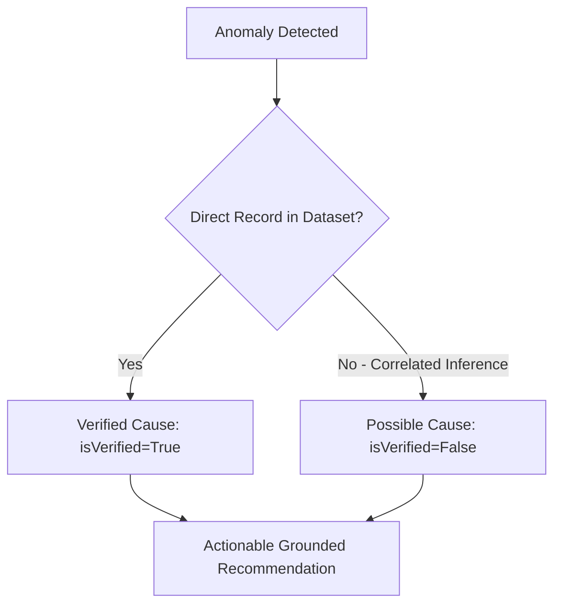

# LoomPilot Monitoring AI Agent: Architecture & Technical Specification

## 1. System Overview

The **Monitoring AI Agent** is an industrial plant intelligence and factory operations supervision service built for **LoomPilot**, an AI-powered manufacturing management platform.

Its primary mission is to serve as the plant manager's autonomous operational co-pilot across textile manufacturing facilities:
1. **Fleet Availability & Status Supervision**: Tracks 100% of factory machines, categorizing them into actively operating, standby/idle buffer, under maintenance, and mechanical breakdown units without fabricating sensor data.
2. **Machine Utilization Governance**: Enforces mathematical utilization rules based on empirical meter hours. When running time logs are absent in the datasets, the agent reports `DATA_UNAVAILABLE` rather than hallucinating metrics.
3. **Production Progress & Schedule Auditing**: Continuously audits planned targets against actual completed output, computes stage achievement percentages, flags bottleneck departments, and detects overdue manufacturing orders.
4. **Privacy-Preserving Workforce Tracking**: Evaluates daily employee attendance, computes workforce availability percentages, verifies shift staffing sufficiency, and reports absent personnel while strictly redacting sensitive personal PII (Aadhaar, address, compensation).
5. **Deduplicated Operational Alerting**: Generates standardized operational alerts across four severity tiers (`CRITICAL`, `HIGH`, `MEDIUM`, `LOW`). Maintains active alert state with composite deduplication keys to prevent spamming duplicate alert IDs for unresolved incidents.
6. **Fact-Grounded Diagnostic Reasoning**: Strictly distinguishes between **Verified Causes** (empirically confirmed by dataset rows) and **Possible Causes** (correlated operational inferences).
7. **Actionable Plant Management Advice**: Produces prioritized, advisory corrective recommendations linked to actual operational deficits, strictly noting that physical operational changes require authorized management workflows.
8. **Multi-Tenant REST & Conversational Intelligence**: Integrated into the FastAPI application with role-based access control (RBAC), supporting both structured JSON telemetry APIs and natural language queries powered by Groq LLM with deterministic template fallback.

```text
┌────────────────────────────────────────────────────────────────────────┐
│                        LoomPilot Data Sources                          │
│   (Machines, MachineStatus, Orders, ProductionReports, Attendance, Emp) │
└───────────────────────────────────┬────────────────────────────────────┘
                                    │
                                    ▼
┌────────────────────────────────────────────────────────────────────────┐
│                         Data Access Layer                              │
│                    DataRepository (Singleton)                          │
└───────────────────────────────────┬────────────────────────────────────┘
                                    │
                                    ▼
┌────────────────────────────────────────────────────────────────────────┐
│                      Monitoring Agent Core Pipeline                    │
│                                                                        │
│   ┌───────────────────────────┐     ┌──────────────────────────────┐   │
│   │      MachineMonitor       │     │      ProductionMonitor       │   │
│   │ (Fleet Status & Util Gov) │     │ (Output, Bottlenecks, Delays)│   │
│   └─────────────┬─────────────┘     └──────────────┬───────────────┘   │
│                 │                                  │                   │
│                 └─────────────────┬────────────────┘                   │
│                                   │                                    │
│                                   ▼                                    │
│   ┌───────────────────────────┐     ┌──────────────────────────────┐   │
│   │     WorkforceMonitor      │     │   OperationalAlertManager    │   │
│   │(Availability & PII Safe)  │     │(Deduplicated Active Alerts)  │   │
│   └─────────────┬─────────────┘     └──────────────┬───────────────┘   │
│                 │                                  │                   │
│                 └─────────────────┬────────────────┘                   │
│                                   │                                    │
│                                   ▼                                    │
│   ┌───────────────────────────┐     ┌──────────────────────────────┐   │
│   │    RootCauseAnalyzer      │     │    RecommendationEngine      │   │
│   │(Verified vs Possible Fact)│     │(Prioritized Plant Guidance)  │   │
│   └─────────────┬─────────────┘     └──────────────┬───────────────┘   │
│                 │                                  │                   │
│                 └─────────────────┬────────────────┘                   │
│                                   │                                    │
│                                   ▼                                    │
│                     ┌───────────────────────────┐                      │
│                     │MonitoringExplanationService│                     │
│                     │ (Groq LLM / Deterministic)│                      │
│                     └───────────────────────────┘                      │
└───────────────────────────────────┼────────────────────────────────────┘
                                    │
                                    ▼
┌────────────────────────────────────────────────────────────────────────┐
│                         FastAPI Endpoints                              │
│  POST /api/agents/monitoring/query                                     │
│  GET  /api/agents/monitoring/factory-health                            │
│  GET  /api/agents/monitoring/machines                                  │
│  GET  /api/agents/monitoring/production                                │
│  GET  /api/agents/monitoring/workforce                                 │
│  GET  /api/agents/monitoring/alerts                                    │
│  POST /api/agents/monitoring/alerts/{id}/acknowledge                   │
│  POST /api/agents/monitoring/alerts/{id}/resolve                       │
└────────────────────────────────────────────────────────────────────────┘
```

---

## 2. Verified Data Sources vs Missing Data Sources

The agent maintains strict data integrity: it operates exclusively on verified records loaded into `DataRepository` and never invents machine telemetry or attendance figures.

| Telemetry / Data Entity | Verified Project File | Status | Description & Fields Utilized |
| :--- | :--- | :--- | :--- |
| **Fleet & Machine Inventory** | `LoomPilot_Machines.xlsx` | **Verified** | 12 machines across 4 departments (`MachineID`, `MachineCode`, `MachineType`, `ProcessArea`, `CapacityUnitsPerDay`, `CurrentStatus`). |
| **Machine Status Snapshots** | `LoomPilot_MachineStatus.xlsx` | **Verified** | 60 snapshot observations across 5 dates (`AvailabilityStatus`, `AvailableCapacityUnitsPerDay`). |
| **Production Orders** | `LoomPilot_Orders.xlsx` | **Verified** | 30 production orders (`OrderID`, `OrderNumber`, `OrderQuantity`, `ProducedQuantity`, `RemainingQuantity`, `RequiredDeliveryDate`, `OrderStatus`). |
| **Production Reports** | `LoomPilot_ProductionReports.xlsx` | **Verified** | 111 process stage reports (`CumulativeProducedQuantity`, `DefectiveQuantity`, `ProcessStage`, `IssueNotes`). |
| **Employee Attendance** | `LoomPilot_Attendance.xlsx` | **Verified** | 2,772 daily attendance records through 2026-10-31 (`AttendanceDate`, `EmployeeID`, `AttendanceStatus`, `HoursWorked`). |
| **Employee Directory** | `LoomPilot_Employees.xlsx` | **Verified** | 21 personnel (`EmployeeID`, `EmployeeName`, `JobRole`, `SupervisorID`). |
| **Machine Hourly Runtime Meters** | *None* | **Missing** | Hourly operating meter run hours and automated downtime counters are unrecorded in active datasets. |
| **Real-time IoT Telemetry** | *None* | **Missing** | Live vibration/temperature sensors and shift schedules are currently unrecorded. |

### Governance Handling of Missing Data
When an operational query asks for **Machine Utilization**:
- Because running meter hours are unrecorded, the agent marks `isCalculable = False` and outputs the explicit note:
  > *"Machine running time logs (operating meter hours / downtime tracking) are not recorded in factory datasets. Per platform governance, machine utilization is marked DATA_UNAVAILABLE rather than estimated."*
- If explicit verified runtime hours are provided in the request payload (e.g. `{"ST-01": 7.5, "CUT-01": 8.0}`), the utilization formula is executed deterministically.

---

## 3. Core Monitoring Disciplines & Mathematical Formulations

### 3.1. Machine Fleet Operations & Utilization

#### Fleet Classification
The agent categorizes all 12 factory machines into operational states:
- **Available**: `CurrentStatus == "Available"` (10 machines)
  - **Operating**: Primary active production machines (`CUT-01`, `CUT-02`, `ST-01`, `ST-03`, `FIN-01`, `QC-01`, `PK-01` = 7 units).
  - **Standby / Idle**: Auxiliary buffer units kept in reserve (`CUT-03`, `STI-04`, `PAC-03` = 3 units).
- **Under Maintenance**: `CurrentStatus == "Maintenance"` (2 machines: `ST-02`, `FIN-03`).
- **Breakdown**: `CurrentStatus in ("Breakdown", "Failed")` (0 machines).
- **Requires Attention**: Any machine under maintenance or breakdown (`ST-02`, `FIN-03`).

#### Machine Utilization Formula
$$\text{Machine Utilization (\%)} = \left(\frac{\text{Actual Running Time}}{\text{Available Production Time}}\right) \times 100$$

Where:
- $\text{Actual Running Time} = \sum \text{OperatingHours}_i$
- $\text{Available Production Time} = N_{\text{machines}} \times \text{ShiftHoursPerDay}$ (Standard: 8.0 hours/shift)

*Benchmark Calculation Example*:
- Input: 2 machines (`ST-01`: 7.5 hrs, `CUT-01`: 8.0 hrs) over 8.0-hr shift ($16.0\text{ available hrs}$).
- Actual = $15.5\text{ hrs}$; Available = $16.0\text{ hrs}$.
- $\text{Machine Utilization} = (15.5 / 16.0) \times 100 = \mathbf{96.88\%}$.

---

### 3.2. Production Progress & Delay Detection

#### Production Achievement Formula
$$\text{Production Achievement (\%)} = \left(\frac{\text{Actual Cumulative Output}}{\text{Planned Production Target}}\right) \times 100$$

#### Delay Detection Condition
An order is classified as **Delayed / Overdue** if and only if:
$$\text{OrderStatus} \neq \text{"Completed"} \quad \land \quad \text{RemainingQuantity} > 0 \quad \land \quad \text{RequiredDeliveryDate} \le \text{AsOfDate}$$

#### Delay Days Formula
$$\text{DelayDays} = \max\left(0, \text{AsOfDate} - \text{RequiredDeliveryDate}\right)$$

#### Empirical Findings (as of 2026-10-31)
- **Total Orders**: 30 orders (15 Completed, 15 In Progress).
- **Total Planned Units**: 23,200 units.
- **Total Produced Units**: 14,272 units.
- **Overall Achievement**: **61.52%**.
- **Active Orders in Progress**: 15 orders.
- **Delayed Orders**: **12 orders** overdue relative to delivery deadlines.
- **Top Overdue Orders**:
  1. `LP-2026-011` (Polo Shirt): Required `2026-09-02`, **59 days late**, 256 units pending ($14.67\%$ achieved).
  2. `LP-2026-012` (Cotton T-Shirt): Required `2026-09-12`, **49 days late**, 154 units pending ($23.00\%$ achieved).
  3. `LP-2026-013` (Denim Jeans): Required `2026-09-18`, **43 days late**, 180 units pending ($28.00\%$ achieved).
  4. `LP-2026-026` (Polo Shirt): Required `2026-09-23`, **38 days late**, 140 units pending ($30.00\%$ achieved).

#### Bottleneck Identification
A manufacturing process stage is flagged as a **Bottleneck** if:
1. **Equipment Constraint**: Any machine assigned to the process area has `CurrentStatus == "Maintenance"` or `"Breakdown"`.
   - *Identified*: **Stitching Area** (`ST-02` offline) and **Finishing Area** (`FIN-03` offline).
2. **Quality Defect Rate**: Cumulative defect percentage $\ge 1.6\%$.

---

### 3.3. Workforce Attendance & Privacy-Safe Monitoring

#### Workforce Availability Formula
$$\text{Workforce Availability (\%)} = \left(\frac{\text{Present} + 0.5 \times \text{HalfDay}}{\text{Total Scheduled Employees}}\right) \times 100$$

#### Staffing Sufficiency Rule
Staffing is evaluated as **Sufficient** if and only if:
$$\text{Workforce Availability (\%)} \ge 85.0\% \quad \land \quad \text{AbsentEmployees} \le 3$$

#### Empirical Findings (Observation Date: 2026-10-31)
- **Total Scheduled Staff**: 21 employees
- **Present Count**: 20 employees
- **Half-Day Count**: 1 employee (Supervisor ID 10)
- **Absent Count**: 0 employees
- **Effective Attendance**: $20 + (0.5 \times 1) = 20.5$
- **Workforce Availability**: $\mathbf{97.62\%}$
- **Sufficiency**: **Sufficient** ($97.62\% \ge 85.0\%$; line staffing is fully adequate across active lines).

#### Privacy Safeguard (PII Redaction)
In accordance with factory compliance and privacy guidelines:
- **Included in Monitoring**: Employee Name, Job Role, Attendance Status, Hours Worked.
- **Strictly Omitted**: Aadhaar numbers, residential street addresses, personal telephone numbers, bank details, and compensation.

---

## 4. Deduplicated Operational Alert Engine

### 4.1. Severity Tiers
- **`CRITICAL`**: Mechanical breakdowns, or production delivery delays $> 14\text{ days}$ (e.g. `LP-2026-011`).
- **`HIGH`**: Machines under maintenance (`ST-02`, `FIN-03`), order delays $1\text{–}14\text{ days}$, or equipment-constrained stage bottlenecks.
- **`MEDIUM`**: Workforce availability deficits ($< 90\%$ or $> 2$ absentees) or elevated defect rates.
- **`LOW`**: Operational telemetry notices (e.g., missing runtime meters).

### 4.2. Deduplication Architecture
To prevent alert fatigue and notification storms, the alert engine computes a deterministic composite key for every candidate event:
$$\text{Deduplication Key} = \text{Category} : \text{RelatedEntity} : \text{IssueType}$$

*Key Examples*:
- `MACHINE:ST-02:MAINTENANCE`
- `MACHINE:FIN-03:MAINTENANCE`
- `PRODUCTION:LP-2026-011:DELAY`
- `PRODUCTION:STAGE:STITCHING`
- `WORKFORCE:ATTENDANCE:2026-10-31`

If an alert matching this key is already active in memory, the engine reuses the existing alert object and preserves its original `alertId` and `detectedTimestamp`. It will never spawn duplicate alert IDs across successive polling calls.

### 4.3. Alert Data Model
```json
{
  "alertId": "ALT-MCH-ST-02",
  "category": "MACHINE",
  "severity": "HIGH",
  "relatedEntity": "ST-02",
  "description": "Machine ST-02 (Industrial Sewing Machine) is currently offline under maintenance in Stitching.",
  "evidence": "Verified record from LoomPilot_Machines.xlsx: MachineID=4, MachineCode='ST-02', CurrentStatus='Maintenance', ProcessArea='Stitching'.",
  "detectedTimestamp": "2026-10-31T11:45:00.000000Z",
  "recommendedAction": "Inspect maintenance log for ST-02, verify technician progress in Stitching, and estimate return-to-service time.",
  "status": "ACTIVE"
}
```

---

## 5. Root-Cause Analysis & Actionable Recommendations

### 5.1. Separation of Causes
The Monitoring Agent strictly distinguishes between what the data *proves* versus what the data *suggests*:



1. **Stitching Capacity Deficit**:
   - **Verified Cause** (`isVerified=True`): Machine `ST-02` is officially offline under maintenance in the Stitching department (Daily capacity: 175 units/day removed).
   - **Possible Cause** (`isVerified=False`): Capacity reduction on `ST-02` is contributing to scheduling backlogs across active orders `LP-2026-011` through `LP-2026-015`.
2. **Order Schedule Slippage**:
   - **Verified Cause** (`isVerified=True`): Order `LP-2026-011` Required Delivery Date was `2026-09-02` with 256 units pending output.
   - **Possible Cause** (`isVerified=False`): Delay may be amplified by equipment downtime in Stitching and batch queuing delays.

### 5.2. Advisory Recommendations Engine
All recommendations are advisory and tagged with actionable steps, priorities, and governance notices:
- **`REC-001`** (`HIGH` | `MACHINE`): Expedite maintenance on `ST-02` to return 175 units/day to active sewing line capacity.
- **`REC-002`** (`HIGH` | `MACHINE`): Expedite maintenance on steam press `FIN-03` to eliminate finishing stage constraints.
- **`REC-003`** (`CRITICAL` | `PRODUCTION`): Re-prioritize line allocation for order `LP-2026-011` (59 days late) and `LP-2026-012` (49 days late).
- **`REC-004`** (`LOW` | `GENERAL`): Implement shift-level runtime hour meters on factory floor terminals to enable automated Machine Utilization tracking.

---

## 6. Consolidated Factory Health Report

The consolidated factory health report endpoint synthesizes metrics across fleet, orders, attendance, alerts, root causes, and recommendations.

### Health Status Determination
$$\text{Status} = \begin{cases}
\text{"DEGRADED"} & \text{if } N_{\text{criticalAlerts}} > 0 \lor N_{\text{delayedOrders}} > 10 \\
\text{"NEEDS\_ATTENTION"} & \text{if } N_{\text{delayedOrders}} > 5 \\
\text{"ATTENTION\_REQUIRED"} & \text{if } N_{\text{maintenance}} > 0 \lor \text{WorkforceAvail} < 90\% \\
\text{"HEALTHY"} & \text{otherwise}
\end{cases}$$

### Complete Sample JSON Response (`GET /api/agents/monitoring/factory-health`)
```json
{
  "reportId": "REP-20261031-01",
  "asOfTimestamp": "2026-10-31T11:45:00.000000Z",
  "asOfDate": "2026-10-31",
  "dataSourcesUsed": [
    "LoomPilot_Machines.xlsx",
    "LoomPilot_Orders.xlsx",
    "LoomPilot_Attendance.xlsx",
    "LoomPilot_Employees.xlsx",
    "LoomPilot_ProductionReports.xlsx"
  ],
  "factoryHealthStatus": "DEGRADED",
  "machineSummary": {
    "total": 12,
    "available": 10,
    "running": 7,
    "idle": 3,
    "maintenance": 2,
    "breakdown": 0,
    "attentionRequired": ["ST-02", "FIN-03"]
  },
  "machineUtilization": {
    "actualRunningTimeHours": null,
    "availableProductionTimeHours": null,
    "utilizationPct": null,
    "formula": "Machine Utilization (%) = (Actual Running Time / Available Production Time) * 100",
    "isCalculable": false,
    "dataAvailabilityNote": "Machine running time logs (operating meter hours / downtime tracking) are not recorded in the active LoomPilot datasets... Per platform governance, machine utilization is marked DATA_UNAVAILABLE rather than calculated from machine status alone."
  },
  "productionSummary": {
    "totalOrdersCount": 30,
    "totalPlannedUnits": 23200,
    "totalProducedUnits": 14272,
    "overallAchievementPct": 61.52,
    "activeOrdersCount": 15,
    "completedOrdersCount": 15
  },
  "delayedOrdersSummary": {
    "delayedOrdersCount": 12,
    "overdueOrderNumbers": [
      "LP-2026-011",
      "LP-2026-012",
      "LP-2026-013",
      "LP-2026-026",
      "LP-2026-014"
    ]
  },
  "workforceSummary": {
    "totalEmployees": 21,
    "presentCount": 20,
    "absentCount": 0,
    "halfDayCount": 1,
    "workforceAvailabilityPct": 97.62,
    "isWorkforceSufficient": true
  },
  "activeAlertsCount": 15,
  "criticalIssuesCount": 8,
  "alerts": [
    {
      "alertId": "ALT-ORD-LP-2026-011",
      "category": "PRODUCTION",
      "severity": "CRITICAL",
      "relatedEntity": "LP-2026-011",
      "description": "Order LP-2026-011 (Polo Shirt) is overdue by 59 day(s). Target delivery was 2026-09-02 with 256 units remaining.",
      "evidence": "Verified record from LoomPilot_Orders.xlsx: OrderID=11, OrderNumber='LP-2026-011', RequiredDeliveryDate='2026-09-02', OrderQuantity=300, ProducedQuantity=44, RemainingQuantity=256, EvaluatedAsOf='2026-10-31'.",
      "detectedTimestamp": "2026-10-31T11:45:00.000000Z",
      "recommendedAction": "Prioritize production scheduling for LP-2026-011 across operational lines; notify customer relationship team of revised delivery timeline.",
      "status": "ACTIVE"
    },
    {
      "alertId": "ALT-MCH-ST-02",
      "category": "MACHINE",
      "severity": "HIGH",
      "relatedEntity": "ST-02",
      "description": "Machine ST-02 (Industrial Sewing Machine) is currently offline under maintenance in Stitching.",
      "evidence": "Verified record from LoomPilot_Machines.xlsx: MachineID=4, MachineCode='ST-02', CurrentStatus='Maintenance', ProcessArea='Stitching'.",
      "detectedTimestamp": "2026-10-31T11:45:00.000000Z",
      "recommendedAction": "Inspect maintenance log for ST-02, verify technician progress in Stitching, and estimate return-to-service time to minimize production scheduling drag.",
      "status": "ACTIVE"
    }
  ],
  "rootCauses": [
    {
      "issueType": "CAPACITY_REDUCTION",
      "relatedEntity": "ST-02",
      "isVerified": true,
      "causeDescription": "Machine ST-02 (Industrial Sewing Machine) in Stitching is officially offline under scheduled/unscheduled maintenance.",
      "supportingEvidence": "LoomPilot_Machines dataset: MachineID=4, Status='Maintenance', DailyCapacity=175.0 units."
    },
    {
      "issueType": "SCHEDULE_DRAG",
      "relatedEntity": "ST-02",
      "isVerified": false,
      "causeDescription": "Downtime on ST-02 likely creates throughput deficits in the Stitching stage, contributing to backlogs in active manufacturing orders.",
      "supportingEvidence": "Stitching operates at reduced fleet capacity while ST-02 is unavailable."
    }
  ],
  "recommendations": [
    {
      "recommendationId": "REC-001",
      "priority": "HIGH",
      "category": "MACHINE",
      "targetEntity": "ST-02",
      "actionText": "Expedite maintenance workflow on machine ST-02 in Stitching and verify technician spare part requirements.",
      "justification": "ST-02 is currently offline (status: Maintenance). Restoring it will return 175 units/day to active capacity.",
      "isAutomatedAction": false,
      "governanceNotice": "Recommendations are advisory. Operational changes require authorized management workflows."
    },
    {
      "recommendationId": "REC-004",
      "priority": "LOW",
      "category": "GENERAL",
      "targetEntity": "Plant Operations & IT",
      "actionText": "Implement shift-level machine operating hours logging (runtime meters) on factory floor terminals.",
      "justification": "Machine status and capacity are tracked, but time-stamped running vs downtime hour meters are currently unrecorded. Daily runtime logging will enable automated Machine Utilization % calculations.",
      "isAutomatedAction": false,
      "governanceNotice": "Recommendations are advisory. Operational changes require authorized management workflows."
    }
  ],
  "missingDataNotice": "Machine running time logs (operating meter hours / downtime tracking) are not recorded in factory datasets. Per platform governance, machine utilization is marked DATA_UNAVAILABLE rather than estimated."
}
```

---

## 7. FastAPI Endpoints & Integration

All endpoints are registered under `/api/agents/monitoring` and enforce Role-Based Access Control via `X-User-Role` headers:

| Method | Endpoint | Query / Body Parameters | Response Model | Description |
| :--- | :--- | :--- | :--- | :--- |
| `POST` | `/api/agents/monitoring/query` | `MonitoringQueryRequest` | `MonitoringQueryResponse` | Natural language or structured operational inquiry. |
| `GET` | `/api/agents/monitoring/factory-health` | `asOfDate: Optional[str]` | `FactoryHealthReport` | Consolidated factory health audit report. |
| `GET` | `/api/agents/monitoring/machines` | `asOfDate: Optional[str]` | `MachineMonitoringResponse` | Machine fleet operational status and utilization. |
| `GET` | `/api/agents/monitoring/production` | `asOfDate: Optional[str]` | `ProductionMonitoringResponse` | Production orders output and schedule delay tracking. |
| `GET` | `/api/agents/monitoring/workforce` | `asOfDate: Optional[str]` | `WorkforceMonitoringResponse` | Attendance metrics and workforce availability %. |
| `GET` | `/api/agents/monitoring/alerts` | *None* | `List[OperationalAlert]` | Active deduplicated operational alerts. |
| `POST` | `/api/agents/monitoring/alerts/{id}/acknowledge` | `alert_id: str` | `{"success": true, ...}` | Acknowledge an active operational alert. |
| `POST` | `/api/agents/monitoring/alerts/{id}/resolve` | `alert_id: str` | `{"success": true, ...}` | Mark an alert resolved and archive it. |

### Access Control Rules
- **Authorized Roles**: `ADMIN`, `PLANT_MANAGER`, `OPERATIONS_DIRECTOR`, `SUPERVISOR`, `ENGINEER`, `AUTHORIZED_STAFF`.
- **Rejected Roles**: `GUEST`, `UNAUTHORIZED`, `CUSTOMER`, `RESTRICTED` $\rightarrow$ Returns **403 Forbidden**.
- **Tenant Validation**: Requesting unknown/invalid tenants $\rightarrow$ Returns **404 Not Found**.

---

## 8. Verification & Test Suite

The Monitoring Agent is verified by a dedicated 15-scenario test suite in `tests/test_monitoring_agent.py`:

```
============================= test session starts =============================
platform win32 -- Python 3.12.3, pytest-9.2.0, pluggy-1.7.0
rootdir: C:\Users\Srinila\OneDrive\Documents\loompilot_ai
configfile: pytest.ini
collected 15 items

tests/test_monitoring_agent.py::test_scenario_01_current_machine_status PASSED [  6%]
tests/test_monitoring_agent.py::test_scenario_02_idle_machine_identification PASSED [ 13%]
tests/test_monitoring_agent.py::test_scenario_03_machine_breakdown_and_maintenance_detection PASSED [ 20%]
tests/test_monitoring_agent.py::test_scenario_04_machine_utilization_calculation PASSED [ 26%]
tests/test_monitoring_agent.py::test_scenario_05_planned_vs_actual_production PASSED [ 33%]
tests/test_monitoring_agent.py::test_scenario_06_production_delay_detection PASSED [ 40%]
tests/test_monitoring_agent.py::test_scenario_07_employee_attendance_summary PASSED [ 46%]
tests/test_monitoring_agent.py::test_scenario_08_workforce_availability_and_sufficiency PASSED [ 53%]
tests/test_monitoring_agent.py::test_scenario_09_operational_alert_generation PASSED [ 60%]
tests/test_monitoring_agent.py::test_scenario_10_duplicate_alert_prevention PASSED [ 66%]
tests/test_monitoring_agent.py::test_scenario_11_consolidated_factory_health_report PASSED [ 73%]
tests/test_monitoring_agent.py::test_scenario_12_missing_dataset_handling PASSED [ 80%]
tests/test_monitoring_agent.py::test_scenario_13_tenant_isolation PASSED [ 86%]
tests/test_monitoring_agent.py::test_scenario_14_unauthorized_access_role_check PASSED [ 93%]
tests/test_monitoring_agent.py::test_scenario_15_empty_dataset_handling_api PASSED [100%]

======================== 15 passed, 1 warning in 1.05s ========================
```

### Full Platform Regression Verification
- **Total Tests Across All Agents**: 79 tests
- **Results**: **79 passed, 0 failures (100%) in 1.81 seconds**
- **Existing Agents Verified**: Quotation Agent, Feasibility Agent, Market Price Agent, Client Assistant Agent, Material Supplier Assistant Agent.

